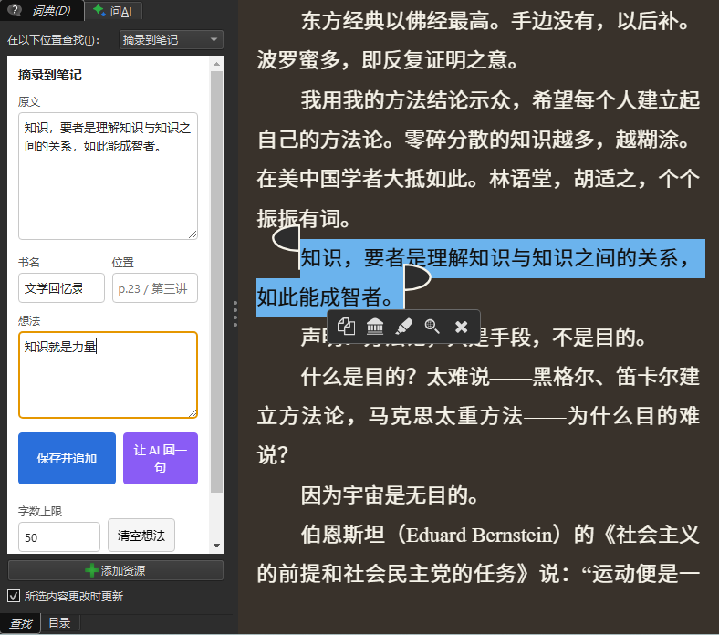

# calibre 摘录笔记（Quote Note）

在 calibre 阅读器里选中一段文字 → 右侧「查找」面板直接变成录入表单 → 写下出处和当时想法 → 追加进一个 Markdown 笔记文件。
可选：让 DeepSeek 针对你的想法回一句（默认 50 字以内，纠正偏颇或补一个角度），一起写进笔记。

不需要安装 calibre 插件，不需要管理员权限，不需要 Node/Python，只用 Windows 自带的 PowerShell。



*选中一段文字后，右侧「查找」面板直接变成录入表单：原文已带入，填书名、位置和想法，点「保存并追加」就进笔记；想法写完可以点「让 AI 回一句」。*

## 技术栈

| 层 | 用了什么 |
| --- | --- |
| 语言 | Windows PowerShell 5.1（系统自带，零依赖） |
| HTTP 服务 | 手写：`System.Net.Sockets.TcpListener` 监听 `127.0.0.1:8765`，自己解析 GET/POST、拼响应头 |
| 前端 | 服务端渲染的 HTML + 内联 CSS，无框架、无构建步骤、无 npm |
| 与 calibre 的集成点 | calibre 9 阅读器「查找」面板的自定义搜索源（`lookup_locations`，URL 模板 `http://127.0.0.1:8765/quote?text={word}`） |
| 存储 | 纯文本 Markdown，追加写入（UTF-8 无 BOM） |
| AI | DeepSeek Chat Completions（OpenAI 兼容接口，`base_url` 可换成任何兼容端点），`Invoke-WebRequest` + 手动 UTF-8 解码 + TLS 1.2/1.3 |
| 启动方式 | VBScript 无窗口拉起 PowerShell，BAT 停止 |

## 为什么是「本地服务 + 面板网页」这种结构

calibre 9 的阅读器（`ebook-viewer.exe`）是独立的 WebEngine 进程，**没有插件 API**，插件按钮只能挂在主界面（书库窗口），挂不到阅读器的选中文字菜单上。

阅读器里唯一留给用户扩展的位置是「查找 / 在以下位置查找」下拉框：它把每个搜索源当成网页，在内嵌浏览器里加载。既然如此，就让这个"网页"是本地服务渲染的表单页——选中的文字由 calibre 通过 `{word}` 占位符传进来，剩下的录入和保存都在本地页面里完成。

顺带一个细节：calibre 的「编辑搜索源」对话框会强制要求 `https://` 开头，但这个校验只存在于那个对话框里，加载时并不检查 scheme。所以脚本直接把 `http://127.0.0.1:8765/...` 写进配置文件即可，不用折腾自签证书。

## 环境要求

- Windows 10 / 11
- calibre 9.x（在 9.19.0 上验证）
- 可选：DeepSeek API Key（不用 AI 功能可以不填）

## 安装

1. **关闭 calibre 阅读器**（所有 `ebook-viewer` 窗口），双击 `安装查词源.bat`。
   脚本会先备份 `%APPDATA%\calibre\viewer-webengine.json`，再加一条名为「摘录到笔记」的搜索源。
2. 双击 `启动摘录服务.vbs` 启动本地服务（无窗口，后台运行）。
3. 打开 calibre 阅读器 → 选中一段文字 → 点工具条上的查词按钮 → 下拉框选「摘录到笔记」。

> 阅读器开着的时候不要改 calibre 配置：退出阅读器时它会用内存里的旧配置覆写文件，你写的改动会消失。安装脚本已经在开头做了检查。

## 使用

表单字段：

- **原文**：自动带入你在书里选中的文字，可以再改
- **书名** / **位置**：出处，保存时拼成 `书名 · 位置`；书名有下拉候选（从已有笔记里自动汇总），上一次填的会自动记住
- **想法**：你自己写的判断

点「保存并追加」写入笔记文件（默认 `我的文档\摘录笔记.md`，可在设置里改）。

### AI 回一句（可选）

1. 在服务目录下打开 <http://127.0.0.1:8765/setup>，把你的 DeepSeek Key 填进去保存；
   或者直接改 `quote_settings.json` 里的 `deepseek_api_key`。
   也可以设环境变量 `DEEPSEEK_API_KEY`，或把 Key 单行放在 `%USERPROFILE%\.dsh\deepseek_api_key.txt`。
2. 写完想法，点「让 AI 回一句」。字数上限在输入框里改（10–400，默认 50）。
3. 觉得那句有用，勾上「把这段 AI 回应一起写进笔记」再保存。

Key 的读取顺序：环境变量 `DEEPSEEK_API_KEY` → `quote_settings.json` 的 `deepseek_api_key` → `%USERPROFILE%\.dsh\deepseek_api_key.txt`。

> 想彻底避免 Key 落进配置文件，就把 Key 设成环境变量 `DEEPSEEK_API_KEY`，然后把 `quote_settings.json` 里的 `deepseek_api_key` 清空。

## 输出格式

```markdown
# 摘录笔记

---

## 2026-11-23 18:03

**原文**

> 哲学家是怀疑者，但怀疑不是终点。
> 你得说出你怀疑的依据。

**出处**：文学回忆录 上 · p.30

**想法**

怀疑是起点，但光怀疑没用，要说清楚凭什么怀疑。

**AI 回应**（50 字以内）

怀疑只是入口，凭什么怀疑才是你要论证的东西。
```

## 文件说明

| 文件 | 作用 |
| --- | --- |
| `quote_server.ps1` | 本地 HTTP 服务：渲染表单、保存笔记、调用 AI |
| `启动摘录服务.vbs` | 无窗口启动服务 |
| `停止摘录服务.bat` | 停止服务 |
| `install_lookup_source.ps1` | 往 calibre 阅读器配置里增删搜索源（带备份） |
| `安装查词源.bat` / `卸载查词源.bat` | 上面脚本的双击入口 |
| `quote_settings.json` | 运行时生成的设置（含 Key，已在 `.gitignore` 里） |
| `quote_settings.example.json` | 设置文件示例 |
| `screenshot.png` | 上面那张截图 |

自检：`powershell -NoProfile -ExecutionPolicy Bypass -File quote_server.ps1 -Test`

## 卸载

1. 双击 `停止摘录服务.bat`
2. 双击 `卸载查词源.bat`（会从 calibre 配置里移除搜索源，并留一份备份）

## 已知限制

- **拿不到书名和页码**：calibre 只把选中文字传给搜索源，位置信息得手填；上一次的书名会被记住，减少重复输入。
- 只支持 Windows（PowerShell 5.1 + VBS + BAT）。
- 服务只监听 `127.0.0.1`，不对外开放；要换端口用 `-Port`。
- 输出是纯追加的 Markdown，不做去重、不加索引。
- PowerShell 5.1 有几个坑已经在代码里绕过了：JSON 响应不带 `charset` 时会按 ISO-8859-1 解码（已改为取原始字节手动 UTF-8 解码）；默认 TLS 1.0 连不上现代 API（已显式设 1.2/1.3）；`.ps1` 存成无 BOM 时中文会按 GBK 解析报错（所有脚本均为 UTF-8 with BOM）。

## 隐私

摘录内容只写到本地文件。只有当你点「让 AI 回一句」时，原文、出处和你的想法才会发给你自己配置的 API 端点。

## 许可

MIT，见 [LICENSE](LICENSE)。
